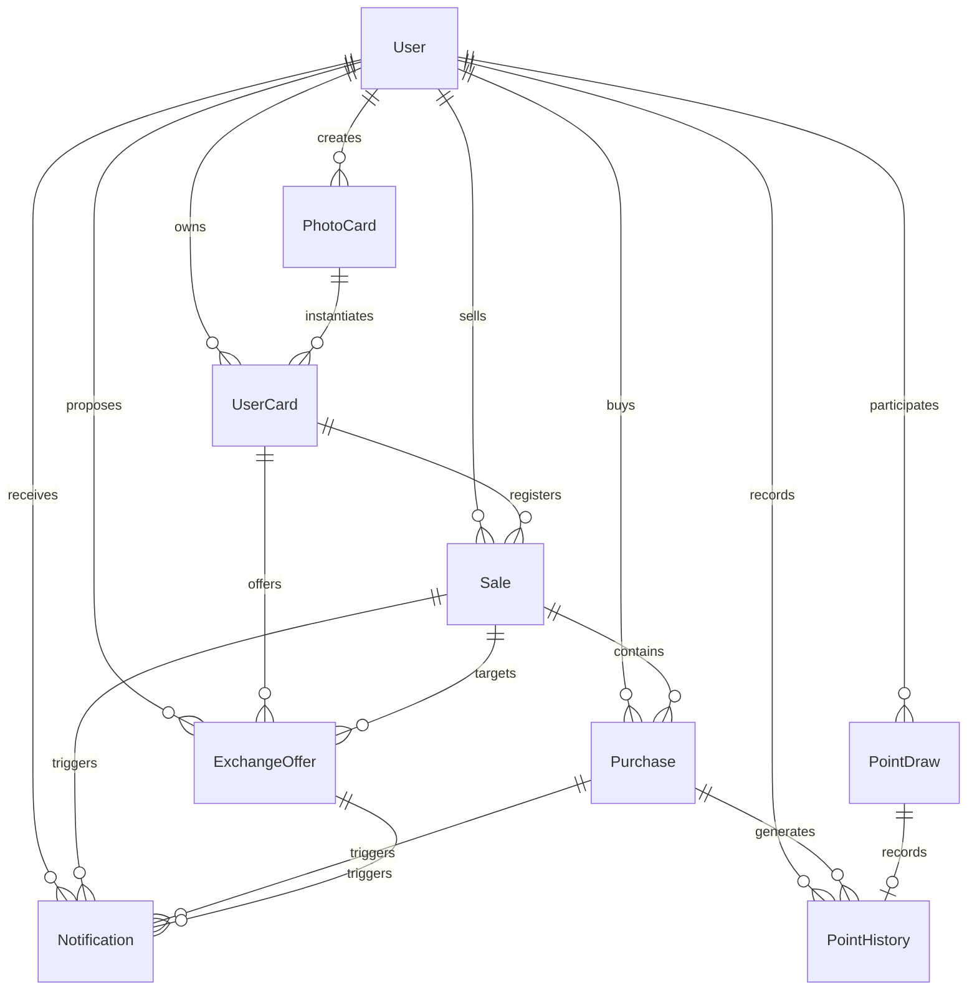
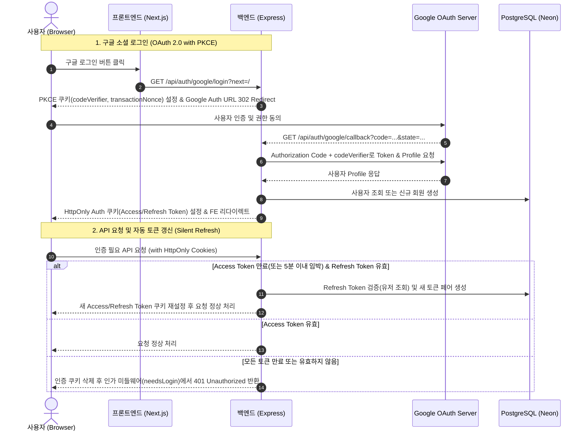
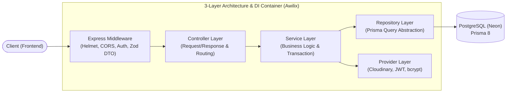

# 📸 최애의 포토 - Backend

> **"최애의 포토카드를 사고, 팔고, 교환하는 디지털 컬렉션 마켓플레이스"**

"최애의 포토"는 좋아하는 아이돌·스포츠 스타·그림의 디지털 포토카드를 사고팔고 교환하며 나만의 컬렉션을 완성하는 팬덤 수집 커뮤니티 플랫폼입니다.

본 저장소는 "최애의 포토" 서비스의 핵심 비즈니스 로직, 회원 인증, 포토카드 거래/교환 트랜잭션, 포인트 시스템 및 실시간 알림 처리를 담당하는 백엔드 API 서버입니다.

- **팀명**: PhoenIV
- **프로젝트 기간**: 2026.10.23 ~ 2026.11.12 (3주)
- **웹 서비스 (FE)**: [🌐 최애의 포토 바로가기](https://15-bias-photo-phoeniv-fe.vercel.app/)
- **백엔드 API 서버**: [🚀 Render API 서버 바로가기](https://one5-bias-photo-phoeniv-be.onrender.com/) _(무료 플랜 특성상 첫 접속 시 50초 내외 Cold Start 발생 가능)_
- **API 명세서 (Swagger)**: [📑 Swagger API 문서 바로가기](https://one5-bias-photo-phoeniv-be.onrender.com/api-docs)
- **서버 헬스체크**: [🩺 서버 상태 확인 (Health Check)](https://one5-bias-photo-phoeniv-be.onrender.com/api/health-check)
- **프론트엔드 저장소**: [📦 프론트엔드 저장소 바로가기](https://github.com/PhoenIV/15-bias-photo-phoeniv-fe)
- **팀 협업 문서**: [📄 Notion 작업 문서 바로가기](https://app.notion.com/p/b0c8c54986818390ad5d018ef529bd16?v=9998c5498681829b87858877c6f5c7b8)

> ⚠️ **저작권 안내**: 본 프로젝트는 비상업적 학습 및 포트폴리오 용도로 제작되었으며, 서비스 내에 활용된 이미지 및 콘텐츠의 모든 권리는 원저작권자에게 있습니다.

## 👥 팀원 구성

임의균(팀장) [개인 Github 링크](https://github.com/Limug-g)

김수지 [개인 Github 링크](https://github.com/cloud2-k)

박수환 [개인 Github 링크](https://github.com/Suhwan-P)

이승현 [개인 Github 링크](https://github.com/MonsteraforCoding)

## 🛠️ 기술 스택

| 구분                    | 사용 기술 및 도구                                               | 선정 및 활용 이유                                                                            |
| :---------------------- | :-------------------------------------------------------------- | :------------------------------------------------------------------------------------------- |
| **Runtime & Framework** | Node.js 24+, Express 5 (ESM)                                    | ESM 지원 및 비동기 라우팅 에러 핸들링이 개선된 최신 런타임 환경                              |
| **Database & ORM**      | PostgreSQL, Prisma 8 (RC, `@prisma/orm-postgres`), Neon DB      | Contract 기반 타입 세이프 쿼리 작성 및 서버리스 PostgreSQL 연동                              |
| **Architecture & DI**   | Awilix (`asClass`, `asValue`)                                   | IoC 컨테이너 기반 의존성 주입으로 계층 간 결합도 완화 및 테스트 용이성 확보                  |
| **Validation**          | Zod                                                             | 환경 변수, DTO 및 요청 데이터 런타임 스키마 유효성 검증                                      |
| **Auth & Security**     | JWT, bcrypt, cookie-parser, Helmet, rate-limiter-flexible, CORS | Access/Refresh 이중 토큰, 비밀번호 단방향 암호화, 무한 입력 방지, HttpOnly 쿠키 및 보안 헤더 |
| **Media Storage**       | Multer, Cloudinary, file-type                                   | 멀티파트 파싱, 매직 넘버 기반 MIME 검증 및 클라우드 이미지 스토리지 연동                     |
| **API Documentation**   | Swagger (`docs/openapi.yaml`, `swagger-ui-express`)             | OpenAPI 3.0 명세 기반 `/api-docs` 대화형 문서 제공                                           |
| **Code Quality**        | ESLint, Prettier, Husky, lint-staged, Commitlint, CodeRabbit    | Git Hook 기반 커밋/포맷팅 자동 검사 및 AI 코드 리뷰 연동                                     |
| **Tool & Infra**        | GitHub, Discord, Notion, Render                                 | 협업 도구 및 Render 기반 클라우드 배포                                                       |

> [!NOTE]
> **Prisma 8 (RC) 채택 및 리스크 관리**: `contract.prisma` 기반의 타입 세이프 쿼리(`@prisma/orm-postgres`)와 향상된 드라이버 성능을 위해 선제 도입하였으며, `pnpm-lock.yaml`을 통한 엄격한 버전 고정으로 RC 버전의 안정성을 관리했습니다.

## 🗄️ 데이터베이스 모델링 (ERD)

포토카드 발행(`PhotoCard`)과 소유권(`UserCard`)을 분리하고, 거래 정합성을 DB 제약 조건(`@@check`, 조건부 유니크 인덱스)으로 보장했습니다.



## 🔐 인증 아키텍처

- **이중 토큰 & HttpOnly 쿠키**: Access Token(15분), Refresh Token(7일)을 자바스크립트 접근이 불가능한 `HttpOnly`·`SameSite('Lax')`·`Secure`(운영 환경) 쿠키에 저장하여 XSS와 토큰 탈취를 방지합니다. _(Next.js Rewrite 프록시로 FE·BE를 같은 출처처럼 처리해 SameSite('Lax')가 동작합니다)_
- **자동 토큰 갱신 (Silent Refresh)**: 전역 `AuthMiddleware`에서 Access Token이 만료되었거나 만료 임박(5분 이내) 시 Refresh Token으로 자동 갱신하여 재로그인 없는 매끄러운 사용자 경험을 제공합니다.
- **구글 OAuth 2.0 (PKCE)**: 인가 코드 가로채기 및 CSRF 공격을 방지하기 위해 PKCE(`codeVerifier`, `transactionNonce`) 및 암호화 서명된 `state`를 적용했습니다.

<details>
<summary><b>구글 OAuth 2.0 & 자동 토큰 갱신 시퀀스 다이어그램 펼치기</b></summary>



</details>

## 💻 팀원별 구현 기능 상세

<!-- 백엔드는 별도의 UI 화면이 없으므로 저는 첨부하지 않았습니다! 스웨거나 이런건 첨부되어도 좋을 것 같구 그외에도 포스트맨 같은 캡쳐 이미지 같은건 추가 원하시면 추가해주셔도 좋을 것 같아요! -->

### 임의균(팀장)

#### 유저 인증·인가

- **회원가입**
  - 이메일·닉네임 중복 검사 (각각 409)
  - 비밀번호는 bcrypt로 해시해서 저장
  - 가입 직후 토큰을 발급해 자동 로그인
  - Zod 스키마로 비밀번호 8~12자(영문 + 숫자) 검증
  - 이메일은 소문자로 통일해 저장·조회
- **로그인**
  - 이메일과 비밀번호 중 무엇이 틀렸는지 알 수 없게 같은 에러(401)로 응답
  - `dummyHash`를 사용해 응답 시간 차이로 가입 여부를 추측하지 못하게 함
- **토큰 관리**
  - JWT Access Token(15분) + Refresh Token(7일)
  - 쿠키 옵션 : `HttpOnly` , `SameSite=Lax`, `Secure` (운영=true, 개발=false)
- **인증 미들웨어 (`authenticate`)**
  - 모든 요청에서 쿠키의 토큰을 검사하고, 유효하면 `req.user = { id }`를 부여
  - Access Token이 만료됐거나 만료 5분 전이면 Refresh Token으로 토큰 재발급, 쿠키 갱신
  - 인증할 수 없는 쿠키는 삭제하고 비로그인 요청으로 통과시킴
  - 로그아웃 요청은 검사에서 제외
- **인가 미들웨어 (`needsLogin`)**
  - 로그인이 필요한 API에 적용하여 `authenticate` 로 통과된 요청들이 여기서 걸러짐
  - 미들웨어 함수를 생성하는 함수 구조로 만들어 다른 미들웨어를 추가할 수 있음
- **로그인 시도 제한 미들웨어 (`loginTryLimit`)**
  - `rate-limiter-flexible`(메모리 방식) 사용
  - 이메일 기준, 6회 부터 15분 차단 (429 + `Retry-After` 헤더), 로그인 성공 시 실패 횟수 초기화
- **내 정보 조회 · 로그아웃**
  - `GET /api/users/me`
  - `POST /api/auth/logout` (쿠키 삭제, 204)

#### 공용 미들웨어

- **요청 검증 (`validate`)**
  - Zod 스키마를 사용, `body`, `query`, `params` 중 원하는 대상을 검증
  - safeParse를 사용해 팀에서 정한 응답 양식 (`fieldErrors`)으로 관리
- **에러 처리 (`errorHandler`)**
  - 직접 정의한 예외는 `{ error: { code, message, fieldErrors } }` 형태로 통일해 응답
  - 라이브러리가 던지는 4xx는 400, DB 유니크 제약 위반은 409, 그 외 에러는 500으로 변환
  - 등록되지 않은 경로는 공통 404 (`notFound`) 예외로 응답

#### 구글 로그인

Authorization Code + PKCE 방식으로 구현했고, 구글 인증이 끝나면 일반 로그인과 같은 자체 JWT 쿠키를 발급합니다.

- **로그인 시작 (`/auth/google/login`)**
  - `state`와 PKCE 값(`code_challenge`)을 만들어 구글 로그인 화면으로 리다이렉트
  - `state`는 HMAC-SHA256으로 서명하고 유효시간은 10분
  - 검증용 값(`nonce`, `codeVerifier`)은 `HttpOnly` 쿠키에 저장 (콜백 경로에서만 전송, 10분 만료)
- **콜백 처리 (`/auth/google/callback`)**
  - 쿠키 값과 `state`를 대조해서 위조·만료·재사용된 요청을 차단 (쿠키는 읽자마자 삭제)
  - `code`와 `codeVerifier`로 구글에서 토큰을 받고, 그 토큰으로 사용자 프로필 조회
  - 로그인 또는 가입 처리 후 자체 JWT 쿠키를 발급하고 FE로 리다이렉트
- **리다이렉트 경로 검증**
  - 로그인 후 이동할 경로(`next`)는 같은 사이트 내부 경로만 허용 (오픈 리다이렉트 방지)
  - 실패하면 `/login?error=코드`로 이동하고, FE가 코드를 안내 문구로 바꿔 모달로 표시

**계정 정책**

- 이미 구글로 가입한 사용자는 그대로 로그인 (`provider` + `providerId`로 식별)
- 구글 이메일이 인증되지 않았으면 실패 처리
- 같은 이메일의 일반 계정이 있으면 가입시키지 않고 409로 안내
- 신규 사용자는 자동 가입. 닉네임은 구글 이름을 사용하고, 중복이면 뒤에 숫자 4자리를 붙여 재시도

#### 랜덤 뽑기 (포인트 뽑기)

- **뽑기**
  - `POST /api/point-draws` (로그인 필요)
  - 100P, 500P, 1000P를 각각 일정 확률로 포인트 지급
  - 쿨다운 : 유저별 1시간에 1회
  - 쿨다운 중이면 429 (`BOX_COOLDOWN`)
- **상태 조회**
  - `GET /api/point-draws/status`로 `canDraw`, `nextAvailableAt`, `serverTime` 반환
  - FE는 `serverTime` 기준으로 남은 시간을 계산해서 기기 시계 차이의 영향을 받지 않음
- **동시 요청 방어**
  - 하나의 트랜잭션에서 유저 행을 잠근 뒤 쿨다운을 판단
  - 더블 클릭이나 여러 탭에서 동시에 눌러도 1회만 지급
- **포인트 이력 기록**
  - 트랜잭션 안에서 뽑기 기록(`PointDraw`) 생성, 유저 포인트 증가, `PointHistory`에 지급액과 지급 후 잔액을 함께 기록

### 김수지

#### 코드 품질 자동화 및 협업 환경 구축

- Husky, lint-staged, Commitlint 기반 커밋/포맷팅 자동화 및 CodeRabbit(AI 코드 리뷰), GitHub Issue·PR 템플릿 구축

#### 포토카드 생성 및 월간 쿼터 제한 (`GET /api/cards/quota`, `POST /api/cards`)

- **당월 생성 한도(월 3회) 관리**: KST 기준 월간 생성 횟수를 실시간 조회하고, 초과 시 `CARD_QUOTA_EXCEEDED` 도메인 예외로 방어 _(동시 요청 레이스 컨디션은 사용자별 락 기반 후속 과제로 분리)_
- **미디어 업로드 롤백 및 트랜잭션 보장**: Multer·`file-type`·Zod로 멀티파트 이미지를 검증해 Cloudinary에 업로드하고, `PhotoCard` 생성과 최초 `UserCard` 발급을 단일 트랜잭션으로 묶어 DB 실패 시 업로드된 이미지를 즉시 삭제(롤백) 처리
- **DB 스키마 리팩토링**: `imageUrl` 대신 `imagePublicId` 단일 식별자 기반으로 전환하여 CDN 및 이미지 변환 파이프라인 유연성 확보

#### 마이갤러리 및 나의 판매·교환 목록 통합 조회 (`GET /api/cards/me`, `GET /api/cards/me/sales`)

- **보유 카드 및 거래 현황 통합 조회**: 마이갤러리에서는 총 보유 수량(`totalQuantity`)과 가용 수량(`netQuantity`)을 분리 응답하고, 나의 판매 목록에서는 판매 등록 건과 `PENDING` 교환 제안 건을 단일 뷰로 통합 제공(검색·다중 필터·정렬·페이지네이션 지원)
- **Faceted Search 기반 등급별 집계(`gradeCounts`)**: 특정 등급 필터 선택 시에도 타 등급 카운트가 0으로 초기화되지 않도록 등급 조건을 분리 집계하고, `Promise.all` 병렬 쿼리로 목록·전체 건수·등급 집계를 동시 처리하여 응답 속도 개선

#### SSE 기반 실시간 알림 시스템 (`GET /api/notifications/stream`, `GET /api/notifications`, `POST /api/notifications/readAll`)

- **실시간 스트림 연결 및 프록시 타임아웃 방지**: 연결 즉시 `ready` 이벤트를 전송하고 프록시 타임아웃·버퍼링 방지를 위해 25초 주기 하트비트(`: keep-alive`)와 `X-Accel-Buffering: no` 헤더를 적용했으며, JWT 세션(Refresh/Access 토큰) 만료 또는 로그아웃 시 `session-expired` 이벤트 전송 후 스트림을 안전하게 종료
- **스마트 알림 조회 및 일괄 읽음**: 최근 7일 이내 알림과 7일이 지났더라도 읽지 않은 알림(`readAt IS NULL`)을 함께 보존 조회하며, 일괄 읽음(`204`) 처리 및 구매/판매/품절/교환 등 6종 비즈니스 트랜잭션 커밋 시 즉시 SSE `changed` 신호 브로드캐스트

### 박수환

(자신이 담당 및 개발한 기능 상세 설명)

### 이승현

(자신이 담당 및 개발한 기능 상세 설명)

## 📂 프로젝트 구조 및 설계 원칙

### 1. 디렉터리 구조

```
15-bias-photo-phoeniv-be
 ┣ 📂docs                                # OpenAPI 3.0 명세서 (openapi.yaml)
 ┣ 📂env                                 # 실행 환경별 환경 변수 (.env.example 참고)
 ┣ 📂migrations                          # Prisma 8 데이터베이스 마이그레이션 이력
 ┣ 📂scripts                             # 데이터베이스 시드 스크립트 (seed.js)
 ┣ 📂src
 ┃ ┣ 📂common                            # 전역 공통 모듈 (상수, Awilix DI, 예외, 라이프사이클)
 ┃ ┣ 📂config                            # 환경 변수 스키마 검증 및 Swagger 설정
 ┃ ┣ 📂controllers                       # HTTP 요청 수신, DTO 검증 및 라우팅 (/api)
 ┃ ┣ 📂middlewares                       # 인증, 인가, DTO/이미지 검증, 에러 핸들러
 ┃ ┣ 📂prisma                            # Prisma 8 Contract(contract.prisma) 및 DB 클라이언트
 ┃ ┣ 📂providers                         # JWT, 암호화, 쿠키, OAuth State, Cloudinary 어댑터
 ┃ ┣ 📂repositories                      # Prisma 기반 데이터 접근 계층 (DAL)
 ┃ ┣ 📂services                          # 핵심 비즈니스 로직 및 트랜잭션 계층
 ┃ ┣ 📜app.js                            # Express 애플리케이션 초기화 및 미들웨어 등록
 ┃ ┗ 📜main.js                           # 서버 부트스트랩 및 실행 진입점
 ┗ 📜prisma.config.ts                    # Prisma 8 ORM 및 Contract 설정
```

### 2. 아키텍처 다이어그램 & 설계 원칙



- **단방향 3-Layer 아키텍처 & 인프라 격리**: `Controller`(라우팅/입력 검증) → `Service`(비즈니스 로직/트랜잭션) → `Repository`(DB 쿼리)로 역할을 엄격히 분리하고, 외부 인프라(Cloudinary, JWT, OAuth)는 `Provider` 계층으로 캡슐화했습니다.
- **표준 도메인 예외 & Graceful Shutdown**: 커스텀 HTTP 예외 계층으로 일관된 에러 응답 포맷(`code`, `message`, `fieldErrors`)을 보장하고, 종료 시그널(`SIGTERM`/`SIGINT`) 수신 시 진행 중인 요청과 DB 커넥션을 안전하게 정리합니다.

## 🚀 시작하기 (Quick Start)

- **사전 요구사항**: Node.js `v24+`, `pnpm v9+`, PostgreSQL 16+ (환경 변수는 `env/.env.example` 참고)

```bash
cp env/.env.example env/.env.development
pnpm install
pnpm prisma:emit  # 선택: contract.prisma 수정 시 Contract 타입/JSON 재생성
pnpm db:migrate
pnpm seed         # 선택: 개발용 기본 시드 데이터 주입
pnpm dev          # 실행 후 http://localhost:5001/api/health-check 에서 정상 기동 확인
```

## 📝 프로젝트 회고록

(추후 첨부 예정)
